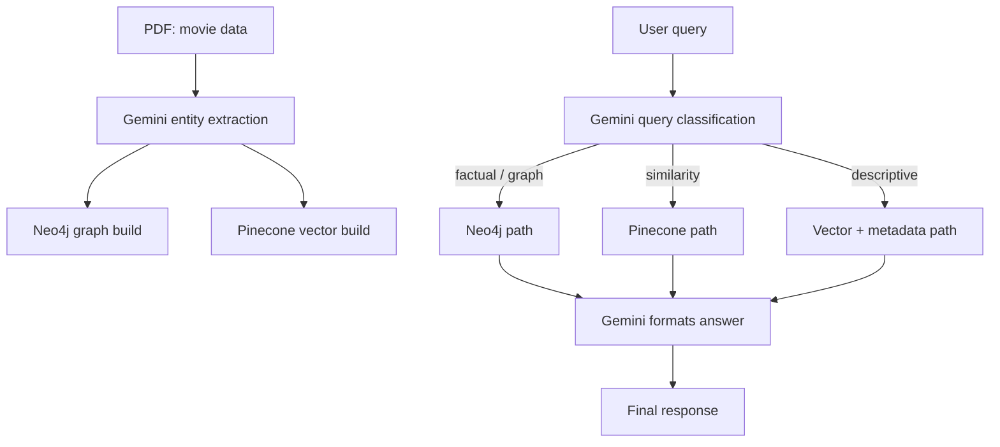

# STRIKEGenAI Lecture 18 & 19

## Zero to Hero Notes for the Movie GraphRAG Project

This project is a practical example of a **GraphRAG pipeline** built for movies.

It combines three layers:

- **Neo4j (Graph DB)** for exact facts and relationships
- **Pinecone (Vector DB)** for semantic similarity and recommendations
- **Gemini** for extraction, classification, planning, and final answer generation

If you understand only one thing from these notes, make it this:

- Use **graph DB** when the question needs truth, structure, or traversal.
- Use **vector DB** when the question needs meaning, similarity, or recommendations.
- Use **Gemini** as the brain that decides what to do and how to explain the result.

---

## 1. What This Project Is Trying To Solve

The raw source is a movie PDF, but a PDF alone is not useful for querying.

The project converts the PDF into two searchable systems:

1. A **knowledge graph** of movie facts
2. A **vector index** of movie meaning

That means the app can answer questions like:

- “Who directed Inception?”
- “Which movies did Leonardo DiCaprio act in?”
- “How many Oscar-winning sci-fi movies are there?”
- “Recommend movies like Inception”
- “Tell me about James Cameron”

The same movie data is stored in two different forms because the questions are different.

---

## 2. The Big Mental Model

Think of the project like this:

### Graph DB = Facts

Neo4j stores relationships such as:

- Movie → DIRECTED → Director
- Actor → ACTED_IN → Movie
- Movie → BELONGS_TO → Genre
- Movie → EXPLORES → Theme
- Movie → WON → Award

So Neo4j is best for questions that need exact structure.

Example:

- “Which movies did Christopher Nolan direct?”
- “Which actors worked in Oscar-winning movies?”

### Vector DB = Meaning

Pinecone stores embeddings, which represent the meaning of a movie description.

So Pinecone is best for questions like:

- “Movies similar to Inception”
- “Recommend a sci-fi thriller”
- “Find something like The Dark Knight”

### Gemini = Orchestrator

Gemini does not replace the databases.

It helps with:

- extracting entities from the PDF
- classifying the user query
- planning the graph query safely
- turning raw results into a friendly answer

---

## 3. Project Flow in One Diagram



In short:

- **Indexing** builds the data stores
- **Querying** decides which store to use
- **Gemini** wraps the result into natural language

---

## 4. File Map: What Each File Does

### Core setup

- [2_config.js](/media/guddu/NewVolume/GEN%20AI/Day-18/2_config.js) sets up Neo4j, Pinecone, Gemini LLM, and Gemini embeddings in one place.

### Indexing pipeline

- [7_runIndexing.js](/media/guddu/NewVolume/GEN%20AI/Day-18/7_runIndexing.js) runs the full indexing workflow.
- [4_entityExtractor.js](/media/guddu/NewVolume/GEN%20AI/Day-18/4_entityExtractor.js) uploads the PDF and extracts structured movie entities.
- [5_graphBuilder.js](/media/guddu/NewVolume/GEN%20AI/Day-18/5_graphBuilder.js) writes movie facts into Neo4j.
- [6_vectorStore.js](/media/guddu/NewVolume/GEN%20AI/Day-18/6_vectorStore.js) creates embeddings and stores them in Pinecone.

### Query pipeline

- [13_runQuery.js](/media/guddu/NewVolume/GEN%20AI/Day-18/13_runQuery.js) is the CLI entry point for asking questions.
- [9_queryClassifier.js](/media/guddu/NewVolume/GEN%20AI/Day-18/9_queryClassifier.js) routes the query type.
- [10_queryPlanner.js](/media/guddu/NewVolume/GEN%20AI/Day-18/10_queryPlanner.js) converts factual questions into a JSON plan.
- [8_cypherTemplates.js](/media/guddu/NewVolume/GEN%20AI/Day-18/8_cypherTemplates.js) turns the plan into safe read-only Cypher.
- [11_factualHandler.js](/media/guddu/NewVolume/GEN%20AI/Day-18/11_factualHandler.js) handles graph/factual questions.
- [12_similarityHandler.js](/media/guddu/NewVolume/GEN%20AI/Day-18/12_similarityHandler.js) handles movie recommendations.
- [14_descriptiveHandler.js](/media/guddu/NewVolume/GEN%20AI/Day-18/14_descriptiveHandler.js) handles “who is X?” / “tell me about X” style questions.

### Commands

- `npm run index` builds the graph and vector store.
- `npm run query` starts the interactive question CLI.
- `npm test` checks the connection setup.

---

## 5. Data Model: What Gets Stored In Neo4j

The graph model is small but expressive.

### Nodes

- `Movie { title, year }`
- `Director { name }`
- `Actor { name }`
- `Genre { name }`
- `Theme { name }`
- `Award { name, category }`

### Relationships

- `Director -[:DIRECTED]-> Movie`
- `Actor -[:ACTED_IN]-> Movie`
- `Movie -[:BELONGS_TO]-> Genre`
- `Movie -[:EXPLORES]-> Theme`
- `Movie -[:WON]-> Award`

### Why this model works

This structure lets you ask direct questions and traversal questions.

Examples:

- “Which director directed Avatar?”
- “Which actors acted in Titanic?”
- “Which sci-fi movies explore dreams?”
- “Which movies won an Oscar?”

### Why MERGE is important

The graph builder uses `MERGE`, not `CREATE`.

That prevents duplicates.

Example:

- Without `MERGE`, the actor Zendaya could be inserted many times.
- With `MERGE`, Neo4j reuses the same node.

The file also creates indexes first so `MERGE` stays fast.

---

## 6. Data Model: What Gets Stored In Pinecone

Pinecone stores one embedding per movie.

The important idea is that the vector is not the raw movie data.

It is a mathematical representation of the movie’s meaning.

### What goes into the embedding text

[6_vectorStore.js](/media/guddu/NewVolume/GEN%20AI/Day-18/6_vectorStore.js) builds a clean summary like:

- title
- genres
- year
- director
- actors
- themes
- awards

Example embedding text:

> Inception is a Sci-Fi, Thriller movie released in 2010. Directed by Christopher Nolan. Starring Leonardo DiCaprio, Joseph Gordon-Levitt. The movie explores themes of dreams, reality, and identity.

That text is turned into an embedding and stored in Pinecone with metadata.

### Why metadata matters

Along with the vector, Pinecone stores:

- title
- year
- director
- genres
- themes
- actors
- text

This allows the recommendation handlers to reason over the same movie record without going back to Neo4j.

---

## 7. Indexing Workflow: PDF To Searchable Knowledge

This is the most important end-to-end pipeline in the project.

### Step 1: Run the indexing script

[7_runIndexing.js](/media/guddu/NewVolume/GEN%20AI/Day-18/7_runIndexing.js) orchestrates everything.

It does three things in order:

1. Extract entities from the PDF
2. Build the Neo4j graph
3. Build the Pinecone vector store

### Step 2: Upload the PDF once

[4_entityExtractor.js](/media/guddu/NewVolume/GEN%20AI/Day-18/4_entityExtractor.js) uploads the PDF to Gemini Files API.

Why this matters:

- Gemini can read the document directly
- you do not need a separate PDF parser
- the file is uploaded once and reused for many extraction calls

### Step 3: Extract structured JSON in batches

The extractor asks Gemini to return this shape for every movie:

```json
{
	"movie": {"title": "string", "year": number},
	"director": {"name": "string"},
	"actors": ["string"],
	"genres": ["string"],
	"themes": ["string"],
	"awards": ["string"]
}
```

This matters because the rest of the system depends on clean structure.

If extraction is messy, both the graph and the vector store become noisy.

### Step 4: Build the graph

[5_graphBuilder.js](/media/guddu/NewVolume/GEN%20AI/Day-18/5_graphBuilder.js) turns each JSON movie object into nodes and relationships.

This gives the system exact fact storage.

### Step 5: Build the vector store

[6_vectorStore.js](/media/guddu/NewVolume/GEN%20AI/Day-18/6_vectorStore.js) creates a summary text for each movie, embeds it, and stores it in Pinecone.

This gives the system semantic retrieval.

### What indexing achieves overall

After indexing, every movie has two representations:

- one in Neo4j for precise logic
- one in Pinecone for meaning-based retrieval

That is the heart of GraphRAG.

---

## 8. Query Workflow: Question To Answer

When the user runs [13_runQuery.js](/media/guddu/NewVolume/GEN%20AI/Day-18/13_runQuery.js), the system follows this sequence:

1. Classify the question
2. Route it to the right handler
3. Fetch results from the right store
4. Let Gemini explain the result naturally

### A. Classification

[9_queryClassifier.js](/media/guddu/NewVolume/GEN%20AI/Day-18/9_queryClassifier.js) decides whether the query is:

- `factual`
- `similarity`
- `descriptive`

Examples:

- “Movies directed by Nolan” → factual
- “Movies like Inception” → similarity
- “Tell me about James Cameron” → descriptive

This is the routing brain of the app.

### B. Factual path

If the query is factual, the system uses the graph.

Flow:

1. Gemini creates a JSON query plan
2. The plan is converted into safe Cypher
3. Neo4j runs the query in read-only mode
4. Gemini rewrites the raw rows into a normal answer

This is where Neo4j shines, because the question depends on exact relationships.

### C. Similarity path

If the query is about recommendations, the system uses Pinecone.

Flow:

1. Extract a target movie name if one exists
2. Embed the movie title or the user’s description
3. Query Pinecone for the closest matches
4. Let Gemini rank the best recommendations and explain why

This is where the vector DB shines, because the question is about meaning.

### D. Descriptive path

If the query is “Who is X?” or “Tell me about X?”, the system uses Pinecone metadata.

Flow:

1. Extract the entity name
2. Embed the entity name
3. Search Pinecone for related movie records
4. Let Gemini summarize the result into a human-friendly description

This is useful when the query is broader than a simple fact lookup.

---

## 9. Why The Factual Path Needs A Plan

You may wonder why the app does not directly send user text to Cypher.

The reason is safety and reliability.

### Problem

Natural language is ambiguous.

For example:

- “Actors in Oscar-winning sci-fi movies”

This could mean several different traversals and filters.

### Solution

Gemini first turns the question into a structured JSON plan.

Example plan:

```json
{
  "steps": [
    { "type": "traversal", "from": "Actor", "rel": "ACTED_IN", "to": "Movie" },
    { "type": "traversal", "from": "Movie", "rel": "WON", "to": "Award" },
    {
      "type": "traversal",
      "from": "Movie",
      "rel": "BELONGS_TO",
      "to": "Genre"
    },
    { "type": "filter", "field": "Award.name", "op": "=", "value": "Oscar" },
    { "type": "filter", "field": "Genre.name", "op": "=", "value": "Sci-Fi" },
    { "type": "projection", "fields": ["Actor.name"], "distinct": true }
  ]
}
```

Then the template system builds safe Cypher from that plan.

This is much safer than allowing raw LLM-generated Cypher.

---

## 10. Why The Template Layer Matters

[8_cypherTemplates.js](/media/guddu/NewVolume/GEN%20AI/Day-18/8_cypherTemplates.js) is the safety net.

It only allows:

- specific labels
- specific relationships
- specific properties
- specific operators

That means the LLM cannot sneak in destructive commands.

So instead of raw AI-generated database code, the app uses:

- LLM for understanding
- templates for control
- Neo4j for execution

That is a good pattern in production systems.

---

## 11. Lecture 18: What Was Introduced

Lecture 18 is the baseline GraphRAG pipeline.

### Main ideas

- extract structured data from a PDF
- store exact facts in Neo4j
- store semantic meaning in Pinecone
- use Gemini to route and explain answers

### Strengths of Lecture 18

- clear separation between graph and vector use cases
- safe graph query generation
- simple query classification
- one pipeline for both factual and recommendation style questions

### Limitation of Lecture 18

It can still feel split into multiple paths.

The user query is classified early, and the handling branches out before any deeper entity grounding.

That works, but it is not yet the smartest possible routing strategy.

---

## 12. Lecture 19: What Improved

Lecture 19 builds on the same foundation but makes the system more intelligent before routing.

### Main upgrades described in the lecture

1. **Entity resolution first**
2. **Better classification**
3. **Unified graph handler**
4. **Hybrid similarity handling**

### Why entity resolution matters

A user may say:

- “Nolan”
- “DiCaprio”
- “The Dark Knight”

These are short, ambiguous mentions.

Entity resolution tries to map those strings to the actual graph entities before classification or query execution.

That makes the pipeline more grounded.

### Why this helps

It reduces ambiguity and improves answer quality.

Example:

- “show me Nolan movies” is easier to interpret if the system has already resolved “Nolan” to `Christopher Nolan`.

### Unified graph handling

Lecture 19 combines factual, descriptive, and path-style graph questions into a single graph handler.

That means the graph side becomes more reusable and less fragmented.

### Hybrid similarity handling

Lecture 19 also improves recommendations by mixing:

- Pinecone similarity scores
- Neo4j graph signals such as genre and theme overlap

This is important because embeddings alone can be too fuzzy.

The graph can filter or strengthen the recommendations using structured facts.

---

## 13. Lecture 18 vs Lecture 19

### Lecture 18

- strong baseline GraphRAG architecture
- separate factual, similarity, and descriptive routes
- direct query classification
- Neo4j for facts, Pinecone for similarity

### Lecture 19

- adds entity resolution before routing
- improves classification with grounded context
- unifies graph handling
- uses hybrid graph + vector reasoning for better recommendations

### Simple way to remember the difference

- **Lecture 18:** “Route first, then answer.”
- **Lecture 19:** “Resolve first, then route, then answer.”

---

## 14. Worked Examples

### Example 1: “Movies directed by Christopher Nolan”

This is a factual query.

What happens:

1. Classifier marks it as factual
2. Planner creates a graph plan
3. Cypher template builds a safe query
4. Neo4j returns matching movies
5. Gemini turns the list into a natural response

Why graph DB is used:

- the answer depends on a direct relationship: Director → DIRECTED → Movie

### Example 2: “Movies like Inception”

This is a similarity query.

What happens:

1. The system extracts “Inception”
2. It embeds the title
3. Pinecone retrieves similar movie vectors
4. Gemini chooses the best recommendations from the candidate list

Why vector DB is used:

- the question is semantic, not factual
- you want “movies with similar meaning,” not just the same genre label

### Example 3: “Tell me about James Cameron”

This is descriptive.

What happens:

1. The system extracts the entity name
2. Pinecone searches related movie records
3. Gemini summarizes the known metadata into a short description

Why this is not purely graph:

- the graph knows relationships
- but the descriptive answer needs a broader summary of what the person is associated with

### Example 4: “Actors in Oscar-winning sci-fi movies”

This is a factual graph traversal with filters.

What happens:

1. Gemini creates a plan with traversals and filters
2. Safe Cypher is generated
3. Neo4j finds actor names through Movie, Award, and Genre links
4. Gemini formats the result

This is a classic graph question because it depends on multi-hop relationships.

---

## 15. When To Use Each Component

### Use Neo4j when you need:

- exact relationships
- shortest-path or multi-hop traversal
- counts and filters over structured facts
- trustworthy results without semantic fuzziness

Examples:

- “Which director worked on which movie?”
- “How many movies won an Oscar?”
- “Find actors connected to genre X”

### Use Pinecone when you need:

- similarity search
- recommendation ranking
- semantic retrieval
- broad descriptive matching

Examples:

- “What movies feel like Inception?”
- “Recommend a mind-bending thriller”
- “Find movies similar to Nolan style”

### Use Gemini when you need:

- extraction from messy source text
- classification of query intent
- query planning
- final summarization and explanation

Examples:

- turning PDF text into JSON
- turning user text into query steps
- turning database rows into an answer

---

## 16. The Full Workflow In Plain English

If you want the simplest possible summary, it is this:

1. Read the PDF with Gemini.
2. Convert movie data into structured JSON.
3. Store exact facts in Neo4j.
4. Store semantic meaning in Pinecone.
5. Ask a question through the CLI.
6. Gemini decides whether the question is factual, similarity-based, or descriptive.
7. Route to Neo4j or Pinecone.
8. Let Gemini explain the result in natural language.

That is the whole project.

---

## 17. Key Takeaways To Remember

- **Neo4j is for relationships and correctness.**
- **Pinecone is for meaning and similarity.**
- **Gemini is the orchestration layer.**
- **Indexing creates both representations from the same source.**
- **Query routing decides which representation to use.**
- **Lecture 19 makes the system more grounded with entity resolution.**

If you can explain those six points, you understand the project.

---

## 18. One-Line Revision Note

If someone asks what this project demonstrates, answer this:

> A practical GraphRAG system where Neo4j handles facts, Pinecone handles similarity, and Gemini coordinates extraction, routing, and natural-language answers.
